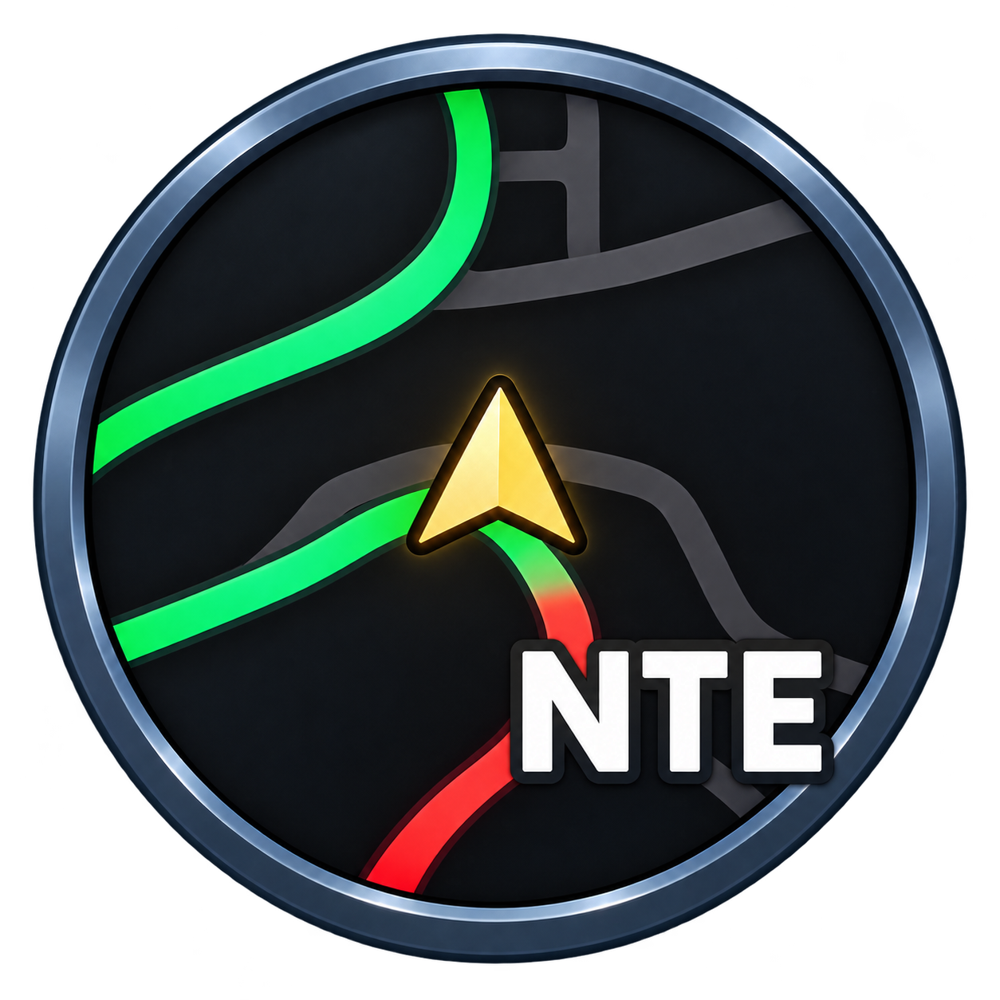

# NTEminiMapAlwaysUp



让《异环 / Neverness to Everness》的小地图箭头始终朝上。程序捕获游戏窗口，识别箭头方向，将旋转后的小地图以鼠标穿透窗口覆盖在原位置。

支持 `HTGame.exe` 和 `NTECloudGame.exe`。不读取游戏内存，不修改游戏文件，不安装自启动。

## 下载与启动

从 [Releases](https://github.com/xyxyx718/NTEminiMapAlwaysUp/releases) 下载 ZIP，完整解压到可写文件夹，优先双击 **启动小地图.cmd**。不要直接在压缩包内运行。

| 发布包 | .NET 要求 | 适用情况 |
| --- | --- | --- |
| `framework-dependent` | 需要 .NET 9 Desktop Runtime x64 | 包较小，已经安装 .NET 或允许启动器补装 |
| `self-contained` | 自带 .NET，无需预装运行库 | 不确定目标机器是否安装了 .NET |

两个包的 **MinimapUp.exe 都在最外层**，主程序与依赖已合并为单文件。图标也已嵌入。`arrow-template.png`、`scripts/` 和其他随包文件应保留。直接运行 EXE 会绕过外部依赖检查；缺少 .NET 时，小包无法靠自身完成检查。

系统要求：Windows 10 2004（内部版本 19041）或更新版本，x64。建议使用无边框窗口模式；不同 HUD 布局、缩放、HDR 和独占全屏效果需要现场验证。

### 自动依赖检查

- 启动器使用 Windows 自带的 Windows PowerShell 5.1，不依赖 .NET 9。
- 小包缺少 .NET 时，经确认通过 WinGet 精确安装 `Microsoft.DotNet.DesktopRuntime.9`，不安装 SDK。
- 两个包的驾驶文字识别均依赖 Windows 简体中文 OCR。缺少时，经确认通过 Windows 按需功能安装 `Language.OCR~~~zh-CN~0.0.1.0`，它不包含在自带 .NET 包中。
- 只有实际补装才申请管理员权限和联网；依赖齐全时直接启动。跳过 OCR 安装也可启动，取消“仅在驾驶模式下启用”即可使用基础功能。
- 安装结果记录在程序旁的 `dependency-install.log`。Windows 若要求重启，请重启后重新运行启动器。

## 使用

默认覆盖原小地图。取消勾选“覆盖原小地图”可在右侧预览。

| 选项 | 默认值 / 行为 |
| --- | --- |
| 检测间隔 | 33 ms，可调 16–1000 ms |
| 连续检测到后显示 | 100 ms，可调 0–5000 ms |
| 连续未检测到后隐藏 | 100 ms，可调 0–5000 ms |
| 仅在驾驶模式下启用 | 开启 |
| 本程序获得焦点时也显示 | 开启 |
| 点击关闭按钮时最小化到托盘 | 开启 |

显示 / 隐藏按实际经过的时间滤波，0 表示立即切换。短暂漏检期间保留上一帧；切出到其他程序、游戏最小化、暂停或捕获失败时立即隐藏。设置自动保存在程序旁的 `settings.json`，“恢复全部默认设置”重置所有配置。

驾驶模式在窗口右侧 35% 宽、下方 75% 高的区域内搜索文字，不限定行位或选项顺序。识别到 **刹车、手刹、加速、切换舒适模式、开启智能驾驶、下车、后视镜** 任意一个，且同时检测到小地图，才允许显示。兼容键鼠、Xbox / PlayStation 提示及汽车、摩托车等布局。

OCR 在后台运行，状态区显示命中词及耗时。它不保证每个检测间隔内完成，文字过淡、遮挡或识别错字仍可能漏检。关闭驾驶模式限制可完全跳过 OCR。

| 快捷键 | 功能 |
| --- | --- |
| Ctrl+Alt+F8 | 暂停 / 恢复 |
| Ctrl+Alt+F9 | 切换覆盖 / 右侧预览 |
| Ctrl+Alt+F10 | 真正退出程序 |

最小化或关闭到托盘后，双击托盘图标恢复面板。托盘右键“退出”始终真正退出。菜单打开期间暂停刷新，避免干扰点击。

## 捕获与录屏

使用 Windows.Graphics.Capture 直接捕获游戏窗口，覆盖层不会回到输入画面中。没有使用 `SetWindowDisplayAffinity` 或 `WDA_EXCLUDEFROMCAPTURE`，避免旧实现被 NVIDIA 视为阻止桌面录制的应用。

若希望录像包含旋转覆盖层，应使用能捕获外部覆盖窗口的桌面捕获方式；只抓游戏源可能不包含它。NVIDIA 的实际录制、不同硬件和 HDR 的完整兼容性尚未全面验证。

当前小地图位置和金色箭头模板以 3840×2160、16:9 HUD 校准，并随游戏客户区高度缩放。`settings.json` 中的 `CenterX / CenterY / Radius` 是高度归一化到 1080 后的坐标，默认 `156 / 140 / 108`。

## 从源码构建

需要 .NET 9 SDK 和 Windows。普通使用者下载 Release 即可，无需 SDK。

```powershell
# 普通开发构建，输出 app/，同时运行行为检查
.\scripts\Build-App.ps1

# 同时构建小包与自带 .NET 包，运行发布包检查并生成 SHA256
.\scripts\Package-Release.ps1 -Version 0.1.0
```

ZIP 和校验文件输出到 `artifacts/releases/`。打包只从本次干净的发布输出取文件，不包含用户设置、日志、调试符号、源码或截图。首次构建自带 .NET 包可能需要从 NuGet 下载运行时包。未启用裁剪，以保持 WinForms / WinRT 兼容性。

## 测试

```powershell
.\app\MinimapUp.exe --test-behavior
.\app\MinimapUp.exe --test (Resolve-Path .\tests\fixtures\reference.png).Path
.\app\MinimapUp.exe --analyze (Resolve-Path .\tests\fixtures\failure-angle.png).Path
.\app\MinimapUp.exe --test-driving (Resolve-Path .\tests\fixtures\driving-keyboard.png).Path
```

`--test-behavior` 检查滤波、默认设置和关键词逻辑；`--test` 检查截图及其旋转变体；`--analyze` 和 `--test-driving` 输出实际识别结果。离线截图检查不等于实际驾驶验证。9 张原始样本已纳入 Git，`driving-rearview-only.png` 仅保留本地。样本用途见 [tests/README.md](tests/README.md)。

## 目录

- `src/`：应用源码。
- `Assets/`：图标、箭头模板和图标生成提示词。
- `scripts/`：启动、依赖检查、构建、图标及双版本打包脚本。
- `tests/`：行为检查和原始截图样本。
- `app/`、`artifacts/`：本地程序、用户配置、构建缓存与诊断结果，不纳入 Git。

## 许可证

原创代码、脚本与文档采用 [MIT](LICENSE)。游戏截图、提取的箭头模板、底层游戏美术和商标不在本项目的 MIT 授权范围内；第三方运行库保留各自条款，见 [THIRD_PARTY_NOTICES.md](THIRD_PARTY_NOTICES.md)。本项目是独立工具，不是官方游戏产品。
